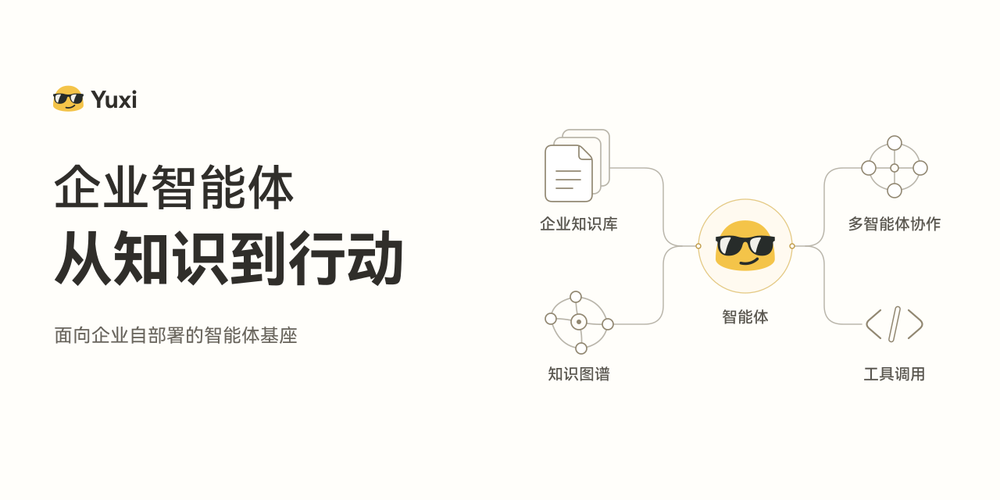
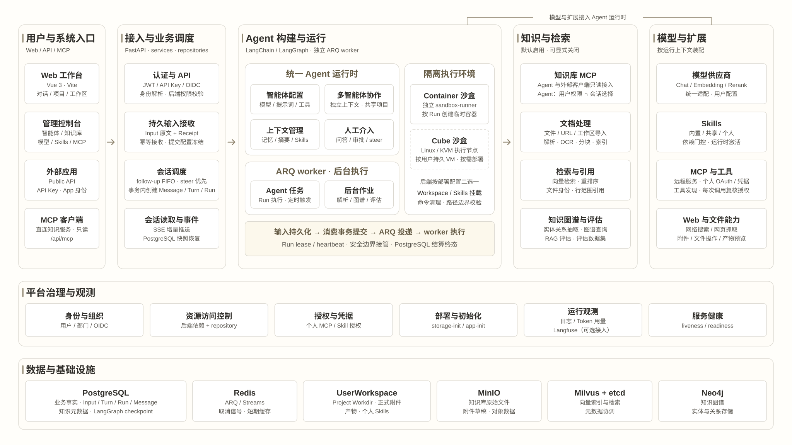
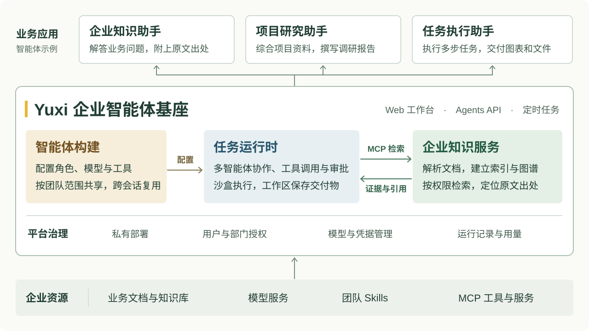

**Yuxi is a self-hosted platform for building and running enterprise agents.** Teams can give an agent their internal documents, tools, and working instructions, then have an administrator share it with selected people or departments. Colleagues can use the same agent to look up sources they have permission to read or to produce reports, charts, and files in a project workspace.

<a href=".github/media/community-qr.png"></a>

**[Watch the demo (Chinese)](https://www.bilibili.com/video/BV1erE26iEgv/) · [Run locally](#quick-start)** · [Documentation](https://xerrors.github.io/Yuxi/) · [中文](README.md)

<a href="https://trendshift.io/repositories/24335"></a>

<br clear="left" />


*In this food safety compliance review, the team can read the findings in the conversation and open the Markdown report or HTML compliance matrix in the panel on the right.* [Explore the screenshot gallery](#feature-showcase)

## What Yuxi Can Do

- **Answer questions using company knowledge.** Index policies, product manuals, or project documents. Readers can follow a citation back to the source to check an answer. External assistants can also query authorized sources through the read-only knowledge MCP service.
- **Deliver files from multi-step tasks.** Agents can delegate to sub-agents, call tools, and run commands in an isolated sandbox. Team members can review approval requests and preview, download, or reuse the resulting files in the project workspace.
- **Share agents across a team.** Capture a procedure as a Skill, select the agent’s model, sources, and tools, and set who can use it. Employees can work in the web app, while business applications can create sessions, submit tasks, and retrieve results through the Agents API.

## System Architecture

[](.github/media/architecture.svg)

<details>
<summary>Show the business and platform capability overview</summary>



</details>

## Quick Start

Install Docker with Compose v2 and get a [SiliconFlow API key](https://cloud.siliconflow.cn/i/Eo5yTHGJ) for initialization.

```bash
git clone --branch v0.8.0 --depth 1 https://github.com/xerrors/Yuxi.git
cd Yuxi
./scripts/init.sh
docker compose --profile container up --build -d
```

In Windows PowerShell, use `.\scripts\init.ps1` in place of `./scripts/init.sh`.

To try the [v0.8.1.beta1 prerelease](https://github.com/xerrors/Yuxi/releases/tag/v0.8.1.beta1), use `v0.8.1.beta1` as the clone tag. [Full installation guide](https://xerrors.github.io/Yuxi/intro/quick-start) · [Production deployment and isolation](docs/advanced/deployment.md)

## Feature Showcase

<details>
<summary>Conversations, task status, and approvals</summary>

Follow a running task and see the command an agent asks you to approve.

**Long-running task tracking**


**Human approval and file delivery**


</details>

<details>
<summary>Knowledge bases, retrieval testing, and RAG evaluation</summary>

A self-hosted Milvus knowledge base supports parsing, chunking, and hybrid keyword and vector retrieval. Administrators can build a Neo4j knowledge graph from indexed chunks or compare retrieval results against a question set. Read-only connectors can also query existing Feishu, Dify, and Notion sources, subject to each connector’s capabilities.

**Knowledge base management**


**Document ingestion and parsing status**


**Knowledge base types**


**Retrieval testing and reranking**


**RAG evaluation**


**Q&A generation**


**Multi-hop Q&A generation**


**Evaluation results**


[Document processing and OCR](docs/advanced/document-processing.md) · [Knowledge graphs](docs/advanced/knowledge-base-graph.md) · [Retrieval evaluation](docs/intro/evaluation.md)

</details>

<details>
<summary>Knowledge graphs and knowledge maps</summary>

Explore entities and their relationships in a knowledge graph, or use the knowledge map to browse files by topic.

**Knowledge graph exploration**


**Graph construction and index status**


**Knowledge map**


</details>

<details>
<summary>Agent collaboration, Skills, and MCP tools</summary>

Sub-agents maintain separate conversation histories and exchange files through a shared project directory within a collaboration tree. Team members can inspect tool calls, answer questions, and review approval requests during a run. They can open generated files, such as an HTML brief, in the browser.

**Yuxi multi-agent orchestration**


**Agent configuration**


**Parallel sub-agent execution**


**Skills and MCP extensions**


**Online Skill editing**


**Skill permissions and dependencies**


**Built-in tools**


[Session collaboration](docs/agents/session-cooperation.md) · [Managing Skills](docs/agents/skills-management.md) · [Connecting MCP tools](docs/agents/mcp-integration.md)

</details>

<details>
<summary>Sandbox workspace, file previews, and delivery</summary>

Open a generated brief, inspect its contents, and save the delivered file from the conversation.

**Yuxi sandbox workspace and artifacts**


**Workspace file management**


**Online file preview**


**File delivery cards**


</details>

<details>
<summary>Team access, model configuration, and usage</summary>

Administrators can grant access and management rights by user or department, configure model providers and credentials, and review model, tool, and token usage. When teammates use a shared agent, retrieval is still scoped to each user’s permissions and the knowledge bases selected for the session.

**Team governance and operations**


**User and department permissions**


**Model providers and capabilities**


**System dashboard**


**Usage and operational metrics**


[Resource permissions](docs/mechanisms/resource-permissions.md) · [Model configuration](docs/intro/model-config.md) · [Usage tracking](docs/advanced/model-usage-tracking.md)

</details>

## Documentation

| Task | Where to start |
| --- | --- |
| Build an agent for a team | [Configure and share agents](docs/agents/agents-config.md) · [Develop an agent backend](docs/agents/agent-backend-development.md) |
| Embed an agent in an application | [Agents API quick start](docs/intro/agents-api-quickstart.md) · [CLI](docs/intro/cli.md) · [Local API reference](http://localhost:5050/docs) |
| Query company knowledge from an external assistant | [Knowledge MCP service](docs/advanced/knowledge-mcp.md) · [API keys](docs/advanced/api-key-integration.md) |
| Plan a production rollout | [Deployment](docs/advanced/deployment.md) · [Sandbox isolation](docs/mechanisms/sandbox.md) · [Concurrency and capacity](docs/advanced/agent-concurrency-capacity.md) |
| Get oriented in the codebase or investigate an issue | [Find code by task](docs/mechanisms/index.md#从一个任务开始) · [Architecture and execution flow](ARCHITECTURE.md) |

[Project overview](docs/intro/project-overview.md) · [Changelog](docs/develop-guides/changelog.md) · [DeepWiki](https://deepwiki.com/xerrors/Yuxi)

## Contributing

Issues, documentation improvements, bug fixes, and new features are welcome. See [CONTRIBUTING.md](.github/CONTRIBUTING.md) for the development workflow and the [contribution guide](docs/develop-guides/contributing.md) for the full guidelines.

Thanks to all contributors for supporting this project!

<a href="https://github.com/xerrors/Yuxi/contributors">
  
</a>

---

Yuxi's implementation and documentation draw on the following excellent open-source projects:

- [LightRAG](https://github.com/HKUDS/LightRAG): Early graph construction and retrieval ideas.
- [DeepAgents](https://github.com/langchain-ai/deepagents): Deep agent framework.
- [DeerFlow](https://github.com/bytedance/deer-flow): Sandbox agent architecture ideas.
- [RAGFlow](https://github.com/infiniflow/ragflow): Document chunking strategies.
- [LangGraph](https://github.com/langchain-ai/langgraph): Agent orchestration foundation.
- [QwenPaw](https://github.com/agentscope-ai/QwenPaw): Model configuration and personal file area design.

## License

Yuxi itself is licensed under the MIT License. See [LICENSE](LICENSE) for details. Third-party components included through Docker Compose retain their own licenses. Before redistribution or commercial deployment, check the upstream licenses and source-code obligations for the actual image versions you use; see the [production deployment guide](docs/advanced/deployment.md) for the relevant boundaries.

[](https://github.com/xerrors/Yuxi)
