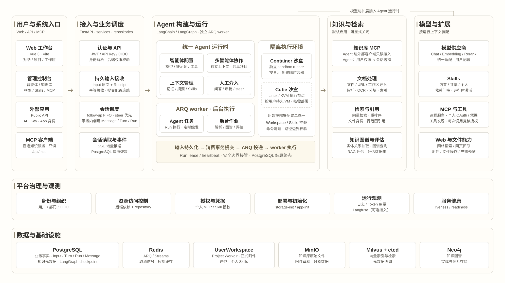
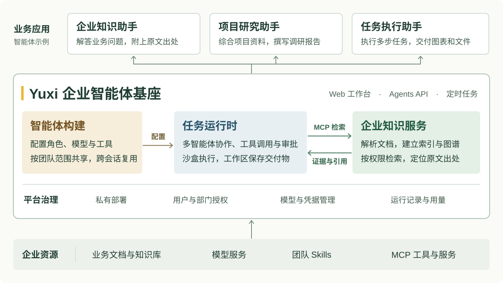

**Yuxi 是可私有部署的企业智能体基座。** 团队可以把内部资料、常用工具和工作方法配置成专用智能体，由管理员共享给相应的成员或部门。成员使用同一个智能体，各自按权限查资料、核对出处，也可以把调研或分析任务交给它，在项目工作区取回报告、图表和文件。

<a href="https://trendshift.io/repositories/24335">

**[看演示视频](https://www.bilibili.com/video/BV1erE26iEgv/) · [本地快速启动](https://xerrors.github.io/Yuxi/intro/quick-start)**

[项目文档](https://xerrors.github.io/Yuxi/) · [版本记录](https://github.com/xerrors/Yuxi/releases) · [微信交流](.github/media/community-qr.png) · [English](README.en.md)

 

*食品安全合规分析完成后，成员可以在对话中阅读结论，也可以打开右侧的 Markdown 报告和 HTML 合规矩阵。* [查看更多功能截图](#能力展示)

## Yuxi 能做什么

- **用企业知识回答问题。** 把制度、产品手册或项目资料建成知识库。成员提问后，可以从引用回到原文核对依据。外部助手也能通过知识库 MCP 在授权范围内检索资料。
- **把多步任务交付成文件。** 智能体可以将任务分给子智能体，调用工具，在隔离沙盒中执行命令。成员可以参与审批，在项目工作区预览、下载或继续使用生成的文件。
- **让团队复用自己的智能体。** 把工作方法写成 Skills，为智能体选择模型、知识库和工具，再设置共享范围。员工从 Web 工作台使用，已有业务系统通过 Agents API 创建会话、提交任务并读取结果。

## 系统架构

展开精简版：业务应用与基座能力

## 快速启动

本地试用 `v0.8.0` 需要 Git、Docker（含 Compose v2）和初始化用的 SiliconFlow API Key。默认 Container 沙盒适合单租户可信任务。[安装并启动 Yuxi](https://xerrors.github.io/Yuxi/intro/quick-start) · [生产部署与隔离](docs/advanced/deployment.md)

试用预发布功能时，请在获取代码时选择 [v0.8.1.beta1](https://github.com/xerrors/Yuxi/releases/tag/v0.8.1.beta1)，再按安装文档初始化。

**用一份熟悉的文档试试。** 把它加入知识库，问智能体一个你知道答案的问题。打开引用核对原文，再请它把要点整理成一份可下载的 Markdown 简报。[知识库入门教程](https://github.com/xerrors/Yuxi/blob/v0.8.0/docs/intro/knowledge-base.md)

## 能力展示

会话、任务状态与人工审批

任务运行时可以跟进执行进度。智能体请求审批时，对话里会列出准备执行的命令，供成员确认。

**长任务执行状态**

**对话中的命令审批**

知识库、检索测试与 RAG 评估

自建 Milvus 知识库支持解析、分块、向量与关键词混合检索。管理员还可以从已索引的文档块构建 Neo4j 知识图谱，或用自己的问答集比较检索效果。已有飞书、Dify 或 Notion 资料库可按连接器支持的范围只读接入。

**知识库管理**

**文档入库与解析状态**

**知识库类型与外部数据源**

**检索测试与重排序**

**RAG 评估**

**问答生成**

**多跳问答生成**

**评估结果**

[文档处理与 OCR](docs/advanced/document-processing.md) · [知识图谱](docs/advanced/knowledge-base-graph.md) · [知识库评估](docs/intro/evaluation.md)

知识图谱与知识导图

图谱展示文档中的实体及其关系，知识导图则按目录和主题组织文件。可以分别从关系或文件结构入手探索资料。

**知识图谱浏览**

**图谱构建与索引状态**

**知识导图**

智能体协作、Skills 与 MCP 工具

子智能体分别保存会话历史，同一协作树的成员通过项目目录交换文件。长任务执行期间，成员可以查看工具调用、回答问题或处理审批，还可在浏览器中预览生成的 HTML 简报。

**多智能体编排**

**智能体配置**

**子智能体并行执行**

**Skills 与 MCP 扩展**

**在线编辑 Skill**

**Skill 权限与依赖**

**内置工具**

[会话协作](docs/agents/session-cooperation.md) · [Skills 管理](docs/agents/skills-management.md) · [MCP 工具接入](docs/agents/mcp-integration.md)

沙盒工作区、文件预览与交付

成员可以打开智能体生成的简报查看正文，也可以从对话中的交付卡片把文件保存到工作区。

**沙盒工作区与文件产物**

**工作区文件管理**

**在线文件预览**

**将交付文件保存到工作区**

团队权限、模型配置与用量

管理员可以按用户和部门划分资源的使用与管理范围，配置模型供应商和凭据，并在看板查看模型、工具与 Token 用量。成员共用同一智能体时，知识检索仍受当前用户权限和会话选择限制。

**团队治理与运行管理**

**部门与用户管理**

**模型供应商与凭据管理**

**系统监控看板**

**用量与运行指标**

[资源权限](docs/mechanisms/resource-permissions.md) · [模型配置](docs/intro/model-config.md) · [用量统计](docs/advanced/model-usage-tracking.md)

## 文档导航

| 我想做什么 | 从这里开始 |
| --- | --- |
| 给团队配置一个专用智能体 | [配置与共享智能体](docs/agents/agents-config.md) · [开发智能体后端](docs/agents/agent-backend-development.md) |
| 把智能体嵌入现有应用 | [Agents API 入门](docs/intro/agents-api-quickstart.md) · [命令行工具](docs/intro/cli.md) · [本地 API 文档](http://localhost:5050/docs) |
| 让外部助手检索企业知识 | [知识库 MCP 接入](docs/advanced/knowledge-mcp.md) · [API Key 配置](docs/advanced/api-key-integration.md) |
| 准备上线或评估容量 | [生产部署](docs/advanced/deployment.md) · [沙盒与隔离](docs/mechanisms/sandbox.md) · [并发容量](docs/advanced/agent-concurrency-capacity.md) |

[项目介绍](docs/intro/project-overview.md) · [变更记录](docs/develop-guides/changelog.md) · [DeepWiki](https://deepwiki.com/xerrors/Yuxi)

## 参与贡献

欢迎提交 Issue、改进文档、修复 Bug 和贡献功能。开发流程见 [CONTRIBUTING.md](CONTRIBUTING.md)，完整规范见 [文档参与指南](docs/develop-guides/contributing.md)。

感谢所有贡献者的支持！

</a>

---

## 许可证

Yuxi 本体采用 MIT License，详见 [LICENSE](LICENSE)。Docker Compose 引入的第三方组件遵循各自的许可证；再分发和商业部署前，请按实际镜像版本核对上游许可和源码义务，相关边界见[生产部署指南](docs/advanced/deployment.md)。

Yuxi 的实现和文档参考了以下优秀的开源项目：

- [LightRAG](https://github.com/HKUDS/LightRAG)：早期图谱构建和检索思路；
- [DeepAgents](https://github.com/langchain-ai/deepagents)：深度智能体框架；
- [DeerFlow](https://github.com/bytedance/deer-flow)：沙盒智能体架构思路；
- [RAGFlow](https://github.com/infiniflow/ragflow)：文档分块策略；
- [LangGraph](https://github.com/langchain-ai/langgraph)：智能体编排基础；
- [QwenPaw](https://github.com/agentscope-ai/QwenPaw)：模型配置和个人文件区域设计。

## Star History

<a href="https://www.star-history.com/?repos=xerrors%2Fyuxi&type=date&legend=bottom-right">
 <picture>
   <source media="(prefers-color-scheme: dark)" srcset="https://api.star-history.com/chart?repos=xerrors/yuxi&type=date&theme=dark&legend=top-left" />
   <source media="(prefers-color-scheme: light)" srcset="https://api.star-history.com/chart?repos=xerrors/yuxi&type=date&legend=top-left" />
   
 </picture>
</a>
