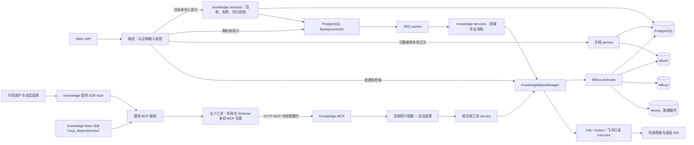
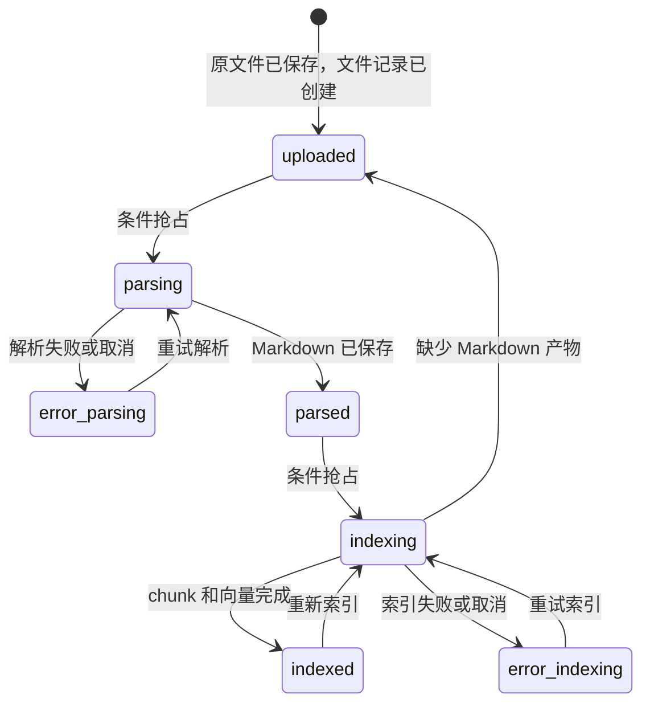

# 知识库机制

本页说明文档怎样从上传走到可检索状态，以及 PostgreSQL、MinIO、Milvus、Neo4j、后台作业 和 Agent 工具各自负责什么。第一次操作知识库请看[创建并使用知识库](../intro/knowledge-base.md)，解析器配置见[文档处理与 OCR](../advanced/document-processing.md)。

## 能力边界

Yuxi 通过 `KnowledgeBaseManager` 读取知识库配置、解析权限并选择 executor：

- `milvus` 是文档型知识库，支持上传、解析、分块、向量索引、预览和检索，也可以构建知识图谱；
- `dify` 和 `notion` 是只读连接器，只保存外部连接信息并执行 Query，不承载 Yuxi 的上传、解析、索引、文件树和全文预览；
- `feishu` 在线搜索配置的知识空间，只返回新版普通文档（Docx）候选；Web 阅读面板和 `open_kb_document` 每次请求实时读取正文文本，不同步入库。表格、旧版文档、附件和快捷方式不属于当前阅读范围。

`supports_documents` 表示本地文档管理能力，`supports_document_read` 独立表示正文阅读能力。飞书连接器保留只读写入门禁；读取前在 executor 重新解析节点并核验空间归属和类型，飞书再按配置的用户凭证检查资源权限。它不提供本地文件树、原件下载或 `find_kb_document`。

飞书连接凭证由管理员配置，获授权的 Yuxi 知识库用户共享该凭证可读范围，使用者不自动映射到自己的飞书身份。Yuxi 权限检查限制谁可以调用此连接，`space_id` 限制连接读取哪个空间；token 在配置响应与日志中不回显。凭证过期或飞书撤权时调用明确失败，管理员可以在配置中更换 token；当前连接不提供用户登录和自动刷新。具体配置见[飞书连接参数](../advanced/knowledge-base-api.md#飞书只读连接配置)。

前端按钮只反映 executor 的能力，最终判断由后端完成。只读连接器收到不支持的操作时会明确报错。

## 两条链路

管理链路改变知识库事实，Agent 链路消费当前用户和当前 Agent 可见的知识库：

管理路由对配置、列表和详情直接调用 Manager，对解析和索引登记后台作业；worker 根据 registry 调用知识库 service，再由 Manager 选择 executor。启用 Knowledge 时，worker 在补发和消费任务前初始化已有知识库执行器，并通过真实 Neo4j 会话确认图谱连接；失败会阻止 worker 启动，Compose 按既有策略重启，pending 意图保持未领取。关闭 Knowledge 时跳过这两个连接步骤。Manager 负责配置和 executor 选择；具体 executor 负责解析、索引和检索。知识库配置的最终值在 PostgreSQL，Redis 只缓存最小运行配置，未命中或异常时回源数据库。

未删除知识库的名称由 PostgreSQL 唯一索引约束，名称不区分大小写，已删除名称可复用。并发创建或重命名冲突返回 HTTP 409，冲突事务不改变已有记录。

## 存储装配与内部边界

`KnowledgeExecutor` 表示按知识库类型复用的执行器，`KnowledgeBase` ORM 表示 PostgreSQL 配置行。Manager 保留配置解析、类型选择、权限摘要和公开结果装配；文件元数据、目录、正文窗口和原件读取直接进入知识域 service/repository，不要求装配检索客户端。类型配置和查询默认值由类型类提供；解析、索引、检索及外部正文阅读才使用执行器。`services/access.py` 拥有用户可见范围，管理路由、Public API 与 Knowledge MCP 在知识域调用该入口；Agent 通过 HTTP MCP 消费授权后的结果。

文档与图谱通过 `knowledge/storage/milvus.py` 装配中文正文、embedding、BM25 函数和索引。文档、实体和三元组各自保留已有列顺序及来源字段。新集合采用统一字段定义，已有集合不自动重建。Milvus 与 Neo4j 查询分别使用每事件循环 8 个线程的预算；调用方取消等待后，实际线程退出才归还容量。

Milvus 执行器持有 `KnowledgeGraphService`，首次图检索在线程内初始化图向量客户端，后续请求复用。Neo4j 连接由基础设施管理，图谱服务协调 PG 事实与 Neo4j/Milvus 投影。一次图谱构建复用一个抽取模型客户端；模型 JSON 归一化负责实体属性合并和关系去重，图 payload 转换只分配局部 ID。

`services/graph_build.py` 拥有构建与向量修复的提交准入、唯一 Job 登记和重置前的活动任务检查。HTTP 路由校验权限并适配响应；worker 消费已登记的 action，直接调用图谱执行器，执行器重新验证知识库类型与锁定配置并持有投影锁。提交预检与重置的活动任务检查各自读取当前事实，不提供跨请求的串行化承诺。

分块入口和配置位于 `chunking/dispatcher.py` 与 `chunking/presets.py`。`ragflow_like` 是借鉴 RAGFlow 思路并经过本地修改的适配实现；其中 parser 使用 Yuxi 的 `source_spans` 保留原文定位，不能按未修改的第三方 vendor 整体替换。语义分块通过 `chunk_parser_config.embed_model_id` 接收模型 spec；索引用例在未指定时注入系统 embedding 配置。缺失模型或装配故障使索引失败，不产出普通切分结果。固定输入的分块和来源范围由 parser 测试拥有。

摄取 chunk 字典、PostgreSQL 行、Milvus 列数组与检索结果各自服务不同边界：dispatcher 生成内容与来源范围，Milvus 执行器明确转换为 PG 字段和向量列，检索再从 PG 补全当前可见文件来源。文件元数据、真实目录树和 HTTP 列表保持各自需要的字段，父关系来自持久化记录。运行时查询以 `MilvusRetrievalConfig` 为默认值，再叠加持久化选项和本次请求；面板使用同一默认配置。前端查询使用后端保存的选项，配置面板只拥有未保存草稿，不在查询页维护另一份运行参数。已有显式配置继续生效，未保存的阈值与 BM25 数量分别取 0.0 和 50。

知识库软删除由 `KnowledgeBaseRepository.mark_deleted` 在一个事务中写入 KB、文件 tombstone 和批量 outbox，清理任务完成外部删除后调用 `purge`。评估成功/失败钩子在后台任务的 owning transaction 中调用 repository 持久化，GET 只读取业务状态并装配进度，不回写终态；筛选和分页由 PostgreSQL 执行。有标准片段的题目在检索零命中时产生零值指标，仍参与平均值和低召回筛选；历史错误得分不自动重算。

## 文档状态机

上传、解析和索引是三个可以分别观察的动作：

`file_status.py` 拥有当前写入状态和历史读取映射。目录写入 `done`；普通文件的历史 `done` 按 `indexed`、`failed` 按 `error_indexing` 筛选，文件列表与跨库搜索使用同一映射。`parsing` 和 `indexing` 表示当前动作已经抢到执行权；处理参数和操作者在领取文件的同一事务中写入，未抢到允许状态的请求不会更改参数。结果发布按 Job → File 顺序锁定记录，核对 Job 的执行代次、未过期 lease 与文件 owner；失权 worker 不能发布新结果或覆盖新 owner。

- `uploaded`：原文件和文件记录存在，尚未完成解析；
- `parsed`：解析后的 Markdown 路径已写入文件记录；
- `indexed`：本次分块、向量写入和统计更新已完成；
- `error_parsing`、`error_indexing`：对应阶段失败或取消，并保存错误信息。

任务接口的响应和 后台作业 状态只表示编排结果。验收时重新读取文件状态，并按需核对 Markdown、chunk、向量和图谱数据。

Milvus 文件的清除图谱、重新解析和 Markdown 编辑需要 manage 权限。清除图谱保留正文、分块和普通检索；重新解析保留原件，撤销旧解析及下游后发布新解析结果；重新入库保留先构建新代次再切换的保障。非运行阶段可编辑可靠正文，无解析指针时可从空稿人工生成正文；保存撤销分块、检索和图谱并回到 `parsed`，保留原件和既有图片。清理索引、清理解析只作为内部编排原子，不提供独立文件菜单或 HTTP 入口。编辑以正文修订拒绝过期保存；冲突或保存结果不明时保留草稿，用户可核对当前正文。保存期间关闭编辑器不会取消任务，关闭前可下载草稿；任务成功后显示已保存并刷新。

## 各存储负责什么

| 存储 | 拥有的事实 | 不拥有的事实 |
| --- | --- | --- |
| PostgreSQL | 知识库配置、权限、文件元数据和状态、chunk 正文与原文行号、图谱处理状态、BackgroundJob 执行意图与 lease | 原文件字节、向量索引 |
| MinIO | 上传原件、解析 Markdown、解析图片 | 文件当前状态、用户权限 |
| Milvus | chunk 向量、BM25/混合检索字段、图实体和关系向量 | 权限、文件状态 |
| Neo4j | 图谱实体、关系和 chunk 关联 | 原文件、权限和检索排序 |
| Redis / ARQ | BackgroundJob 投递与 worker 唤醒、知识库最小运行配置缓存 | BackgroundJob 最终状态、配置最终值、文件状态 |

知识库解析先生成本地 Markdown 目录，再将图片和 Markdown 写入该文档本次解析的独占 MinIO 前缀。文件记录提交 `parsed` 与新 Markdown 路径后，服务回收旧尝试；失败或 owner 丢失只回收未发布的当前尝试，旧产物保持可读。取消发生在结果发布后的旧资源回收阶段时，已发布结果仍然有效。删除文档按文档前缀回收解析资源和 Office 预览，其他文档的资源保留。预览转换持有共享投影锁，发布前重新检查文件有效性；删除清理取得排他锁后回收产物，避免转换在删除之后复活预览。

普通解析和索引任务在领取文件的同一事务内合并并保存执行参数，竞争失败的任务不能改写胜出任务的参数。解析和索引发布按 Job → File 顺序锁定记录，取得文件锁后重新校验执行者与租约；失租任务不能更新解析指针或激活索引代次。documents 服务只负责读取有效 OCR 配置和生成解析产物，知识库状态、执行权及发布仍由知识域拥有。引擎拒绝明确截断或缺少必要结构的响应，合法空白正文与协议失败分别处理。

DOCX 解析在 VML 输入边界区分图片资源与空图形元数据：仅无正文、无子节点，且属性为空或只有 Office 标题的 `imagedata` 不生成图片项。有引用属性（包括空引用）、未知属性或内容的节点继续执行图片提取；资源缺失仍使解析失败并回收本次输出，不发布缺图的部分结果。分类不改写原件。

Milvus 索引会把 chunk 写入 PostgreSQL 和 Milvus。它不是跨存储事务：任一侧失败时会尝试补偿并把文件置为 `error_indexing`，排查时需要同时查看两侧。

分块时保存 `chunk_index`、`start_line` 和 `end_line`，行号以 MinIO 保存的完整解析文本为基准，从 1 开始且包含首尾行；空行也计数，Markdown 和 TXT 使用同一规则。切片、合并与重叠携带原始字符位置，生成的标题与问答前缀不作为原文行。HTML 表格转键值对后的片段保留原 HTML 块范围。

Semantic 将可转换的 HTML 表格的每个数据行生成独立检索块：横向合并只输出一次，纵向合并的类别和条件随行继承，跨逻辑字段的说明保留为正文，不猜测它属于哪个字段。多层列名取显式 `thead`，没有 `thead` 时使用第一行。每行作为完整单元保留，极长行允许超过分块长度目标。`Table KV` 是生成的块标题提示，不是解析引擎或分块开关。已有文件重新分块后应用这些规则；取舍与回归证据见[合并表格行语义](../develop-guides/decisions/implemented/2026-11-02-semantic-merged-table-rows.md)。

CSV 和 Excel 先由 parser 生成 Markdown 表格，QA 分块读取表体，来源范围指向持久化 Markdown 的对应表格行。CSV 首行为列名，不生成问答；XLS/XLSX 不猜测首行用途，使用空结构表头并保留全部原始行，包括未声明的首行内容。字段中的换行、竖线和 HTML 字面值由 parser 编码，QA 按 Markdown 单元格语义读取。检索从当前 active generation 的 PostgreSQL chunk 补齐行号与文件名。当前知识域 Schema 持有这些行号列，部署前提见[部署参考](../advanced/deployment.md#_3-数据库与文件目录)。

文件内容接口同时返回完整解析文本与片段范围，并以 `line_location` 标明能否定位：完整原文可读、文件快照已完成入库、chunk 与该快照的 active generation 相同才可用。原文缺失、入库尚未完成、片段读取失败或读取期间代次改变时，预览显示原因并禁用高亮；失效的检索结果需重新检索。

## 后台作业 和恢复

JobTracker 保存任务登记、执行方上报的进度与结果摘要，并提供管理员查询和取消请求。知识库和评估 service 拥有业务结论：导入登记分别返回成功与失败项，只为成功项登记处理作业；该作业遇到解析或入库失败会结束为失败，批量解析或索引可以执行完成并报告失败计数。进度达到 100 不决定任务终态。后台作业只展示有限资源引用和计数，完整结果从业务资源读取。

普通上传、URL 抓取和工作区导入由 `knowledge/services/uploads.py` 同步暂存原件，计算内容哈希并使用独立对象键。原始名称保存在对象元数据，物理键不承载目录或展示名称；相同内容允许独立文件条目。路由校验权限并适配响应，知识域管理用例调用工作区来源安全读取入口；Workspace filesystem 拥有 no-follow 和有界读取，URL fetcher 拥有白名单与 SSRF 检查。

上传前为现有原件桶配置匹配 `yuxi-knowledge-staging=true` 的七天 MinIO 生命周期规则，只给新暂存对象加该标签，保留其他规则。正式导入复制的原件不携带暂存标签，导入成功回执可在暂存过期后重放。部署前无标签暂存对象不自动删除，需要运维先核对路径、时间和持久引用，再显式补标或清理；七天规则不覆盖这些历史对象。

`knowledge/services/imports.py` 首先检查持久回执，新的导入意图在目录事务前回读原件及指纹、校验来源清单，每次最多登记 500 项。事务内复用或创建真实目录链、分配叶子名称、保存文件、持久导入回执及可选解析作业，提交后投递。回执绑定操作者、知识库、目标、条目及参数；显式 `import_id` 区分主动重新导入，未提供时同一暂存对象清单视为同一意图。重试返回原登记，标识对应不同请求返回 409，文件删除不清除回执。worker 使用已登记文件 ID 解析与索引，不创建额外文件。

文件页摘要按整个知识库的有效文件聚合，目录、软删除文件、当前分页与目录筛选不改变摘要口径。逐状态计数驱动需关注菜单，失败优先于待处理和处理中，正常时隐藏入口；列表保留持久化错误文本，查看原因与重试是独立动作。文件数入口展开大小、Chunks 和 Tokens。

打开文件统计下拉时复用知识库详情读取接口，重新读取已有的 token_count、chunk_count 和文件大小聚合，不遍历分块正文、不改写文件计数或新增后台作业。Token 计数继续由现有入库流程维护。

文件与目录共享同级有效名称空间，根目录也受 PostgreSQL 唯一索引保护。名称执行 NFC、去首尾 ASCII 空格并按数据库 lower 比较，展示保留大小写。上传文件自动分配保留最后扩展名的最小可用整数后缀；中间路径复用同名目录，普通文件占位时明确失败。手动创建、重命名和移动撞名返回 409，删除目录与其他结构写入共享目录树事务。软删除释放名称，失败文件继续占名。完整路径由真实父关系表达，列表读取不创建目录。

浏览器文件与目录上传通过 `useKnowledgeUploadQueue` 管理 XHR 并发、进度与列表状态，并同步返回 Ant Upload 的取消句柄。主动取消不弹出失败提示；同步准备失败在受控列表刷新后投影为错误，结束的请求忽略迟到回调。`FileUploadModal` 拥有来源选择、文件过滤与正式提交；URL 抓取和个人空间导入沿各自的读取与提交时点执行。

提交端在事务完成后发布作业 ID；worker 从共享作业定义加载 Handler，拥有领取、执行、超时和失联检测，用唯一 attempt token claim 作业 并续租 lease；重复投递和失权 worker 的迟到写入会被 PostgreSQL 拒绝。首次发布失败时，pending 作业 保留，启动和周期 publisher 会补发。所有 后台作业 在 owner 中断或 lease 过期后都会明确失败，不自动重放未知外部副作用。领域 failure hook 由 worker 在终态事务中调用，JobTracker 的观察和取消入口不调用这些 Hook。

批量“待解析”和“待入库”入口按状态筛选文件，并通过数据库 dedupe key 拒绝活跃重复任务。取消任务时先保存 `cancel_requested`；pending 任务由 worker 确认无需执行，running 任务由领域 Handler 在安全检查点响应。确认前任务保持原状态，已经终态的记录拒绝迟到写入。重试前保留故障现场，检查文件记录、MinIO、chunk、Milvus 和 Neo4j，再选择重新解析、重新索引或图谱修复。

## Agent 如何看到知识库

Knowledge MCP 服务端把工具级失败返回为错误结果，MCP adapter 转为绑定当前调用的错误 ToolMessage，审计与公开结果保留失败状态。正常检索没有命中时返回成功的空结果。服务端提供安全的错误指导语，工具失败后模型可以继续处理本轮任务。

Agent 保留 `Context.knowledges` 的归一化选择：`"all"` 表示当前可读范围，数组表示固定的会话选择。知识库工具是内置 `knowledge` MCP server 提供的 MCP 工具：运行装配从该 server 的真实目录（initialize + tools/list）取得五个工具的名称、参数 Schema 与说明，每次调用经 HTTP MCP 读取数据；资源选择器和回答引用过滤也通过同一 MCP 边界读取知识库，不直接调用知识库 Manager、repository 或访问 service。选择器和引用过滤通过 `list_kbs(include_capabilities=true)` 取得 `supports_documents` 和 `supports_document_read` 能力摘要；普通工具列表默认不返回这些附加字段。

`knowledge/mcp` 拥有内部凭据与 SDK Auth，直接从可信 Context 读取用户、会话选择和 Run 身份。通用 MCP 装配该认证对象并复用现有 loader，运行工具在每次 HTTP 出站前复查管理员策略；Knowledge Auth 签发五分钟委托 Token。Token 使用部署共享的 `JWT_SECRET_KEY` 与 `YUXI_INSTANCE_ID`，限定 `aud=yuxi-knowledge-mcp`、`purpose=agent-knowledge-read`；普通登录 JWT 不能代替委托。Token 不持久化，不放入模型参数、prompt 或工具结果，用户无需创建内部 API Key 或进行 OAuth 登录。配置和地址见[部署参考](../advanced/deployment.md#可选关闭知识库)。

Knowledge MCP 每个 HTTP 请求验证签名、用途、有效期和账号当前状态；每次工具调用再由知识域按当前用户读取权限查询资源，与 Token 携带的会话选择求交集。工具目标必须属于该范围，文档归属由知识库查询实现校验。撤权后后续调用拒绝该资源；权限查询失败向调用边界传播，不返回空列表掩盖存储故障。授权查询与实际读取遵循各自事务边界。外部 API Key 请求按 Key 所属用户解析全部可读知识库，接入契约见[知识库 MCP](../advanced/knowledge-mcp.md)。

知识库工具由内置 `knowledge-base` Skill 的 `mcp_dependencies: ["knowledge"]` 门控：预加载时首轮由运行装配从内置 server 加载工具；渐进加载时在模型读取 `SKILL.md` 后由 Skills middleware 动态加载。工具职责由[工具系统](../agents/tools-system.md#知识库工具)维护，选择和激活仍受当前资源权限约束。

引用消费 MCP 的结构化结果，保留知识库、文件和原文行范围；已保存引用按同一工具消息和内容身份重投影当前来源字段，保持引用 ID。普通用户的引用阅读调用已有授权正文窗口接口，不依赖管理员文件详情。工具的文本展示块不替代该结果。知识选择器和历史引用读取按当前用户权限执行，不受 Agent 工具启停开关限制，但部署关闭时不可用。

推荐顺序是：列出可见知识库 → 检索候选片段 → 用 `file_id` 打开或定位原文。五个工具的名称、参数 Schema 与结构化结果直接来自 Knowledge MCP 的目录与响应；工具级拒绝按单次调用返回服务端指导语，连接层故障由授权中间件把 `knowledge` server 标记为不可用并在本轮隐藏其工具。

知识库不会挂载为 Agent 可直接遍历的目录；Agent 通过五个只读工具检索和阅读正文，原件下载由知识库管理接口提供。

Knowledge 默认启用。显式关闭后，知识库管理路由和 MCP 均未注册，返回 HTTP 404；Agent 不装配知识库工具，普通聊天继续运行，会话知识选择保留。模型强行调用未声明的工具时，通用授权边界返回拒绝结果，不发生工具执行。待执行任务与清理意图保留，关闭期间不派发或执行知识库任务，已失联任务仍按租约规则收敛。容器停启与数据保留方式由[部署参考](../advanced/deployment.md#可选关闭知识库)维护。

## 权限

知识库的最终授权由后端依赖、Manager 可见性查询和具体工具目标校验共同完成：

- 读取、检索、打开和下载需要 read 权限；
- 创建、更新、添加文件、解析、索引、删除和图谱写操作需要 manage 权限；
- 原文件上传入口要求管理员，并在传入 `kb_id` 时继续检查该知识库的 manage 权限；
- 前端守卫、按钮隐藏、Agent 配置和提示词只控制呈现或缩小范围，不能授予权限。

Agent 的 `knowledges` 只能缩小用户已有权限。协作成员沿用执行用户与 APP 作用域，使用继承或显式选择的 Agent 配置，每次执行仍复查资源可见性。私有解析图片通过带知识库权限校验的 API 读取，MinIO 对象 URL 不是授权凭证。角色与共享范围规则见[资源权限](./resource-permissions.md)。

## 失败和重试

- 解析失败或取消：文件进入 `error_parsing`，查看错误并重新提交解析；批量待解析入口只扫描 `uploaded`。
- 索引失败或取消：文件进入 `error_indexing`，检查分块、嵌入和存储后重新入库；批量待入库入口扫描 `parsed` 和 `error_indexing`。
- 索引缺少 Markdown：文件回到 `uploaded`，先恢复可靠解析正文再入库，不会生成空索引。无解析指针可重新解析或从空稿人工编辑；编辑器读取已有指针失败时明确报错，不得冒充空稿。
- 后台作业 失败、取消或 lease 过期：只能说明后台动作未完成，不能推断外部存储没有部分写入；知识任务不会在未知副作用上自动重放。失败收敛 hook 在同一 PostgreSQL 事务内更新仍由该 Job 拥有的文件错误态与知识库持久统计；已由其他 Job 接管的文件保留其当前状态。详情与文件列表的统计从 PostgreSQL 读取当前聚合，文件提交后的读取直接反映最新状态。
- Redis 缓存异常：Manager 回源 PostgreSQL；不支持的知识库类型或 executor 初始化失败会明确阻止操作。

## 源码定位与验证

按需要修改的用户流程选择入口：

| 维护任务 | 起点与职责 | 继续追踪 |
| --- | --- | --- |
| 管理配置、文件列表和检索调度 | [Manager](https://github.com/xerrors/Yuxi/blob/main/backend/yuxi/modules/knowledge/manager.py) 读取配置、查询可见性并选择 executor | repositories 拥有持久查询；base 与 implementations 拥有文件处理和具体存储操作 |
| 暂存上传、URL 和工作区原件 | [原件暂存 service](https://github.com/xerrors/Yuxi/blob/main/backend/yuxi/modules/knowledge/services/uploads.py) 计算内容指纹并写入独立对象和原始名称元数据 | 路由校验权限并适配响应；管理用例调用工作区安全读取入口，正式文件、目录、导入回执和后台作业由导入 service 登记 |
| 异步导入、解析、索引和图谱构建 | [知识库作业 service](https://github.com/xerrors/Yuxi/blob/main/backend/yuxi/modules/knowledge/services/background_jobs.py) 组织领域动作、进度和失败结论 | background_jobs registry/worker 拥有调度与 lease；文档处理由 Manager 分派，图谱构建直接调用 KnowledgeGraphService |
| 删除与旧代次投影清理 | [投影清理 service](https://github.com/xerrors/Yuxi/blob/main/backend/yuxi/modules/knowledge/services/projection_cleanup.py) 定时消费持久 outbox | 清理独立于 BackgroundJobContext；事件行锁与知识库投影锁保护外部删除，提交 applied 后才完成 |
| Agent 知识能力与委托 | [Knowledge 客户端](https://github.com/xerrors/Yuxi/blob/main/backend/yuxi/modules/knowledge/mcp/client.py) 提供内部认证连接与产品读取；[Knowledge MCP 服务端](https://github.com/xerrors/Yuxi/blob/main/backend/yuxi/modules/knowledge/mcp/server.py) 验证身份、选择范围与工具权限 | 访问 service 查询实时可见性；工具 service 校验目标并组织领域操作 |
| Public API 的知识能力 | [访问 service](https://github.com/xerrors/Yuxi/blob/main/backend/yuxi/modules/knowledge/services/access.py) 查询当前 Key 用户的可读范围；[工具 service](https://github.com/xerrors/Yuxi/blob/main/backend/yuxi/modules/knowledge/services/tools.py) 组织领域工具操作 | Public 路由适配响应，执行时复查可见性与文档归属 |

Agent Context 中的资源选项查询用于配置界面；执行权限仍由访问 service 与实际读取边界核验。增加用例时沿上述 Owner 修改，状态与持久化查询继续留在其负责的领域实现。

- [知识库路由](https://github.com/xerrors/Yuxi/blob/main/backend/yuxi/api/routers/knowledge/management.py)：权限、上传、任务和状态筛选
- [KnowledgeBaseManager](https://github.com/xerrors/Yuxi/blob/main/backend/yuxi/modules/knowledge/manager.py)：配置回源、可见性和 executor 调度
- [知识库基类](https://github.com/xerrors/Yuxi/blob/main/backend/yuxi/modules/knowledge/base.py)：文件状态和解析流程
- [Milvus executor](https://github.com/xerrors/Yuxi/blob/main/backend/yuxi/modules/knowledge/implementations/milvus.py)：分块、双写、检索和重索引
- [只读连接器](https://github.com/xerrors/Yuxi/blob/main/backend/yuxi/modules/knowledge/implementations/read_only_connectors.py)：Dify/Notion 能力边界
- [JobTracker](https://github.com/xerrors/Yuxi/blob/main/backend/yuxi/modules/background_jobs/service.py)：任务登记、进度观察与取消请求
- [后台作业 worker](https://github.com/xerrors/Yuxi/blob/main/backend/yuxi/workers/background_jobs.py)：Handler 执行、lease 与领域终态 Hook
- [作业 Handler registry](https://github.com/xerrors/Yuxi/blob/main/backend/yuxi/modules/background_jobs/registry.py)：领域 Handler 注册和惰性加载
- [Knowledge MCP](https://github.com/xerrors/Yuxi/tree/main/backend/yuxi/modules/knowledge/mcp)：服务端、内部认证、产品读取及知识引用转换
- [知识库 unit tests](https://github.com/xerrors/Yuxi/tree/main/backend/test/unit/knowledge)
- [权限与路由 tests](https://github.com/xerrors/Yuxi/tree/main/backend/test/unit/routers)
- [知识库 HTTP integration](https://github.com/xerrors/Yuxi/blob/main/backend/test/integration/api/test_knowledge_router.py)
- [Public 工具 integration](https://github.com/xerrors/Yuxi/blob/main/backend/test/integration/api/test_public_knowledge_tools.py)

修改状态、权限、存储或 Agent 工具链路时，至少运行对应 unit 和真实 HTTP integration；涉及外部存储时，从 PostgreSQL、MinIO、Milvus 或 Neo4j 回读最终结果。
